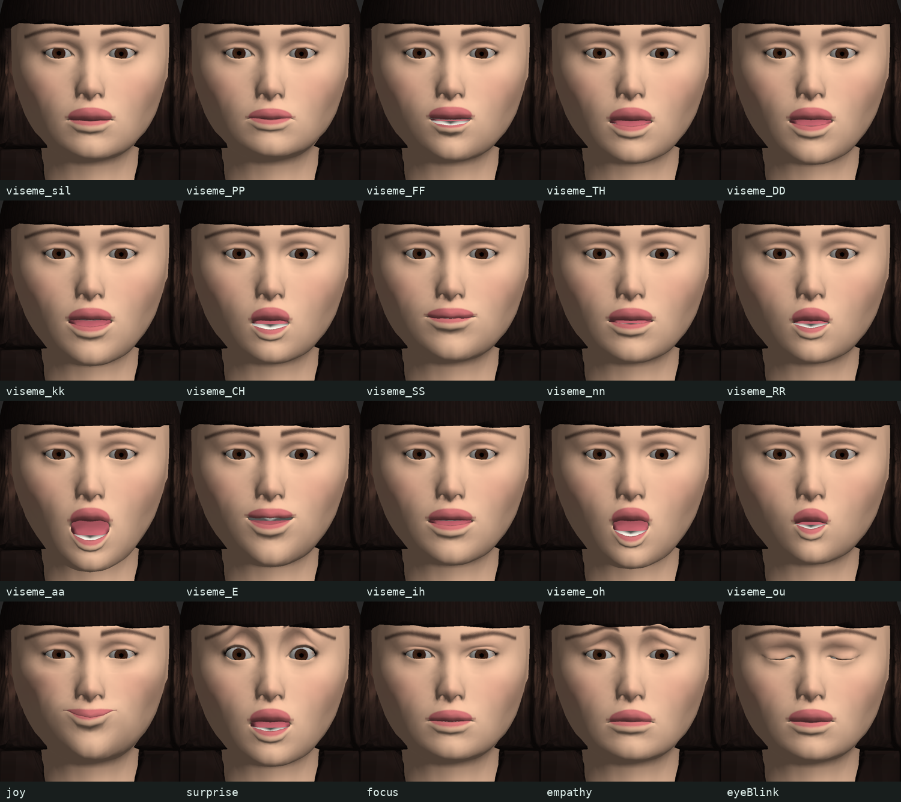

# Jois Avatar Kit

**Живое демо:** https://shrailymadil-debug.github.io/jois-avatar-kit/ — плеер открывается прямо в браузере, без установки.

Реалтайм 3D-аватар для ИИ-компаньона Jois и инструменты к нему: веб-плеер с липсингом
и эмоциями и автопроверка любой `.glb` по критериям приёмки из ТЗ «3D-Дизайнер / Jois».



## Состав репозитория

| Файл | Что это |
|---|---|
| `model/jois_avatar.glb` | аватар для Three.js / Babylon.js: 1 меш, 1 материал, 1 draw call |
| `model/jois_avatar.blend` | исходник для Blender (текстуры упакованы внутрь) |
| `model/jois_avatar.fbx` | исходник FBX (текстуры встроены), для Unity / Unreal / Maya |
| `model/textures/` | атлас: `T_Jois_BaseColor` 4096², `T_Jois_Normal` и `T_Jois_ORM` 2048² (roughness в канале G) |
| `index.html` | точка входа для GitHub Pages, ведёт в плеер |
| `player/` | веб-плеер: липсинг из текста и аудио, эмоции, взгляд, инспектор морфов, автопроверка ТЗ |
| `docs/jois_expressions.png` | все 15 визем, 4 эмоции и моргание на одном листе |
| `docs/validation_report.txt` | отчёт автопроверки по критериям ТЗ |
| `generator/` | исходный код сборки: `build_realistic.py` (текущая модель на базе MakeHuman, ~60 с), `build_avatar.py` (первая стилизованная версия) |

## Характеристики модели и соответствие ТЗ

| Требование ТЗ | Значение |
|---|---|
| Полигонаж 15 000 – 35 000 tris | **33 574** треугольника, 18 760 вершин |
| GLB / GLTF + исходники BLEND / FBX | GLB, BLEND, FBX |
| PBR, атлас для минимума draw calls | 1 материал metallic-roughness, 1 атлас 4K, **1 draw call** |
| Гуманоидный скелет | 23 кости, имена в стиле Mixamo: Hips → Spine → Spine1 → Spine2 → Neck → Head, руки, ноги, **LeftEye / RightEye**; веса перенесены со 163-костного рига MakeHuman |
| 52 ARKit-блендшейпа | **52 из 52**, стандартные имена (`eyeBlinkLeft`, `jawOpen`, `mouthSmileLeft` …) |
| 15 визем | **15 из 15**: `viseme_sil PP FF TH DD kk CH SS nn RR aa E ih oh ou` |
| Эмоции: радость, удивление, фокус, сочувствие | пресеты из ARKit-шейпов, хранятся в `asset.extras.jois.emotions` внутри GLB |
| Изоляция мимики | 0 мм утечки: рот не двигает глаза, брови и глаза не двигают рот |
| Нормали | 0,13% треугольников с расхождением нормалей, 0 вырожденных |
| Растяжения UV | 5,7% площади с анизотропией больше 3:1 |
| Именование на английском | 34 имени: `SK_Jois_Avatar`, `M_Jois_Atlas`, `T_Jois_Normal`, кости Mixamo |
| 60 FPS в Three.js | 80+ FPS в плеере с включёнными липсингом, морганием и анимацией (десктоп); замер на телефоне — кнопкой «Замерить FPS» |
| Размер | 4,9 МБ GLB |

## Как запустить плеер

Онлайн — по ссылке на демо выше. Локально:

```bash
git clone https://github.com/shrailymadil-debug/jois-avatar-kit.git
cd jois-avatar-kit
python3 -m http.server 8080      # или: npx serve .
# открыть http://localhost:8080 — откроется плеер
```

В плеере четыре вкладки: «Речь» (липсинг из текста или аудиофайла), «Эмоции», «Морфы»
(ручная проверка каждого из 67 шейпов) и «Проверка ТЗ» — туда можно перетащить любую `.glb`
и получить отчёт по критериям приёмки.

## Интеграция с голосовым движком Jois

Плеер даёт глобальный объект `window.avatar`:

```js
avatar.say([{ t: 0.00, v: "sil" }, { t: 0.08, v: "SS" }, { t: 0.16, v: "E" }]); // тайминги из TTS
avatar.setViseme("oh", 0.8);          // потоковый режим: виземы по мере генерации речи
avatar.setEmotion("empathy", 0.7);    // neutral | joy | surprise | focus | empathy
avatar.lookAt({ x: 0.3, y: 0.1 });    // или avatar.lookAt() — в камеру
avatar.setWeights({ jawOpen: 0.4 });  // сырые ARKit-веса, например из трекинга лица
```

Плеер работает и с чужими моделями: если в модели есть только ARKit-шейпы без визем,
виземы собираются из ARKit по рецептам (`visemeRecipes` в GLB).

## Как пересобрать модель

```bash
pip install numpy scipy pillow scikit-image fast-simplification bpy
git clone --depth 1 https://github.com/makehumancommunity/makehuman.git   # база MakeHuman (CC0)
MH_DATA=makehuman/makehuman/data python3 generator/build_realistic.py out/   # GLB + атлас
python3 generator/to_blend.py out/jois_avatar.glb out/   # BLEND + FBX
python3 generator/sheet.py out/jois_expressions.png      # лист визем и эмоций
```

## Как сделана модель

Персонаж — молодая девушка с длинными тёмными волосами и чёлкой в школьной форме (тёмно-синий
пиджак, белая рубашка, бордовый галстук, юбка в клетку, чёрные колготки). Сборка полностью автоматическая:

- **база** — реалистичная модель человека MakeHuman (лицензия CC0, разрешено коммерческое использование),
  черты лица настроены морфами: возраст, азиатско-европейский тип, крупнее глаза, тоньше нос, V-образный подбородок;
- **мимика** — 52 ARKit-шейпа собраны из 60 мимических поз лицевого рига MakeHuman (163 кости), затем
  изолированы по зонам; 15 визем — комбинации ARKit-шейпов;
- **глаза, зубы, язык, юбка** — вспомогательные меши MakeHuman, волосы — собственная сетка;
- **одежда** — отдельная «драпировка» поверх тела: сетка сглажена и не проваливается внутрь, поэтому формы тела под тканью не проступают;
- **текстура** — кожа, макияж, брови, ресницы и одежда нарисованы процедурно в атласе 4K.

Кредиты: базовая модель, морфы, скелет, мимические позы и текстура глаза — MakeHuman (CC0).

## Что дальше

Демо-аватар доказывает, что весь конвейер под ТЗ работает от начала до конца (риг, 52 + 15 морфов
с правильными именами, один атлас, Three.js, липсинг, проверка). Финальный персонаж делается по этапам ТЗ:

1. Концепт и high-poly скульпт по брифу Jois (силуэт, стиль, черты лица), скан-качество кожи и волос.
2. Ретопология под 15–35k tris, UV, запекание нормалей, PBR в Substance Painter.
3. Риг и скиннинг, 52 ARKit + 15 визем, проверка изоляции.
4. Экспорт GLB, прогон через ту же автопроверку, замер FPS на телефонах, передача исходников.

На каждом этапе автопроверка из этого набора даёт заказчику объективный отчёт по критериям приёмки.

## Лицензия

Код — MIT. Базовая модель, морфы, скелет, мимические позы и текстура глаза — [MakeHuman](https://github.com/makehumancommunity/makehuman), CC0.
